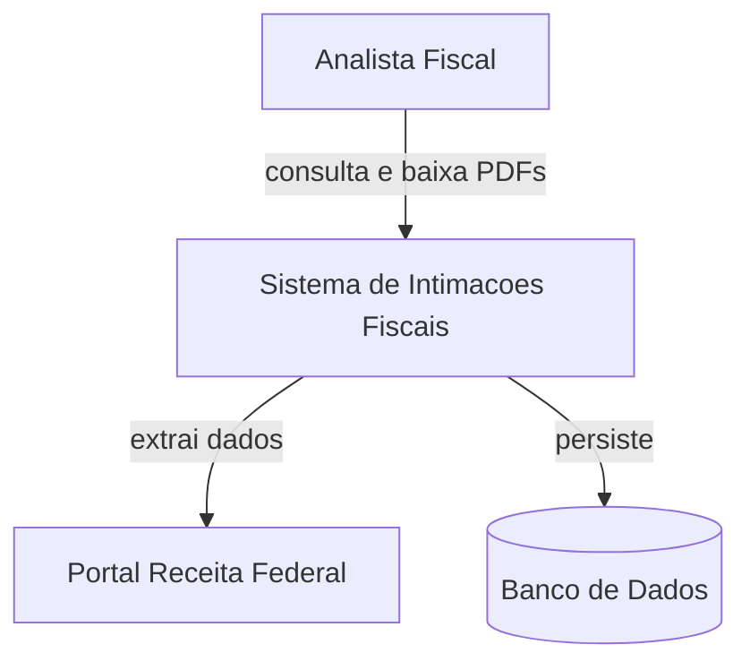
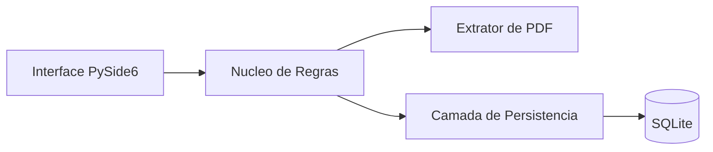
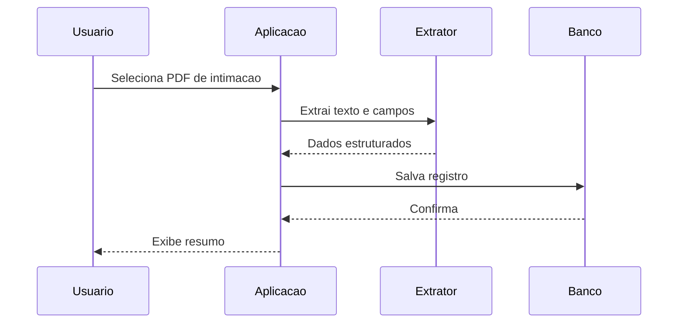
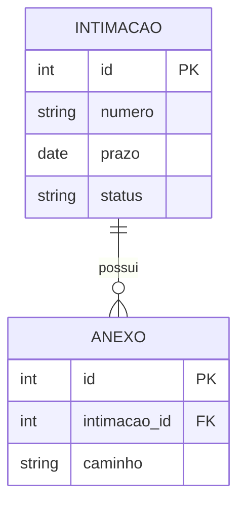
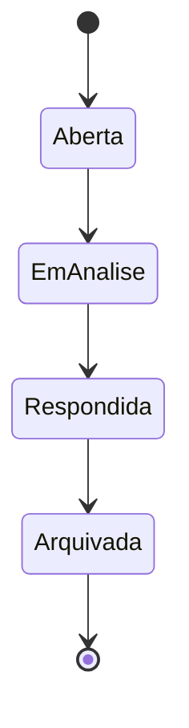

# ARCHITECTURE.md — Diagramas de Arquitetura

Documento vivo, gerado em `docs/ARCHITECTURE.md` ao final da Fase 1. Usa **Mermaid**, que renderiza nativamente no GitHub (README, issues, PRs) e no Google Antigravity, sem plugin nem servidor. É a base do portfólio de engenharia e arquitetura de software.

## Índice
- [Princípios](#princípios)
- [Estrutura do arquivo](#estrutura-do-arquivo)
- [Templates Mermaid](#templates-mermaid)
- [Quando atualizar](#quando-atualizar)

## Princípios

- Um `ARCHITECTURE.md` por projeto, em `docs/` (criar a pasta se não existir).
- Diagramas primeiro, texto curto de apoio depois. O diagrama é o protagonista.
- Sem emojis no conteúdo (regra global). Rótulos de nós em português.
- Cada diagrama tem um título e uma frase explicando o que ele mostra.
- Escolher o tipo de diagrama pelo que precisa comunicar, não usar todos por padrão.

## Estrutura do arquivo

Template do documento:

```markdown
# Arquitetura — [Nome do Projeto]

Visão de arquitetura do sistema. Atualizado em [data].

## 1. Visão geral (contexto)
[Diagrama de contexto: sistema, atores e sistemas externos]

## 2. Componentes internos
[Diagrama de componentes/módulos e suas relações]

## 3. Fluxo principal
[Sequência ou fluxo do caso de uso central]

## 4. Modelo de dados
[ER das entidades principais, quando há persistência]

## 5. Decisões de arquitetura
[Lista curta: decisão, alternativa descartada, justificativa. Espelha o ROADMAP.md]
```

## Templates Mermaid

### Contexto (nível macro — estilo C4 Contexto)
Mostra o sistema no centro, quem usa e com o que conversa.



### Componentes internos
Módulos do sistema e dependências entre eles.



### Fluxo / sequência
Passo a passo do caso de uso central. Bom para documentar a lógica na Fase 3.



### Modelo de dados (ER)
Entidades e relacionamentos, quando há persistência.



### Máquina de estados
Útil para status de um registro (ex.: intimação em aberto → respondida → arquivada).



## Sobre C4

Para projetos maiores, seguir a lógica do modelo C4 usando `graph` do Mermaid: nível 1 Contexto, nível 2 Contêineres, nível 3 Componentes. Não é necessário o `C4Context` nativo do Mermaid (suporte ainda instável em alguns renderizadores) — os `graph TB/LR` acima cobrem os níveis com portabilidade total.

## Quando atualizar

O `ARCHITECTURE.md` é vivo, mantido pelo agente `project-documentation`. Invocá-lo quando:
- Um novo módulo ou integração externa entra.
- Uma decisão de arquitetura muda (refletir também no ROADMAP.md).
- O modelo de dados ganha ou perde entidades.

Cada atualização acompanha a mudança de código, não fica para depois.
