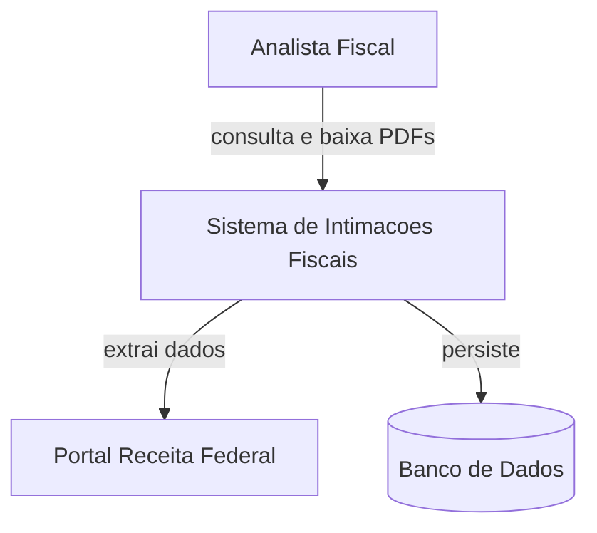
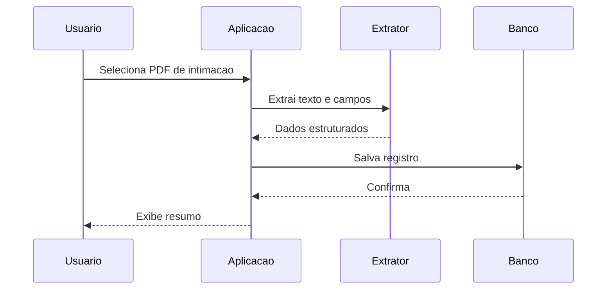
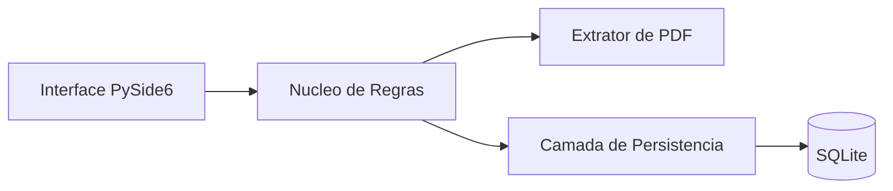
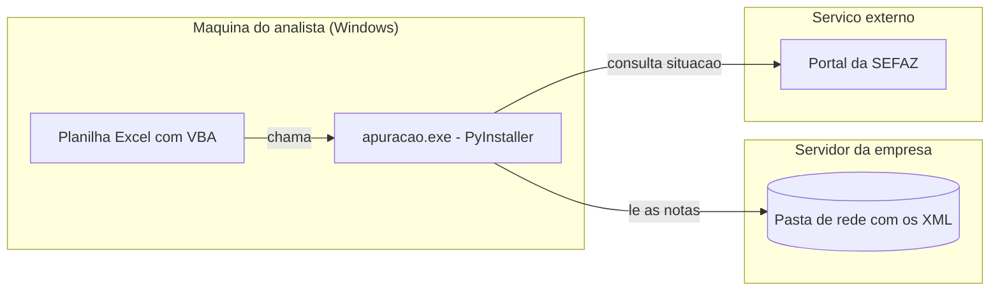
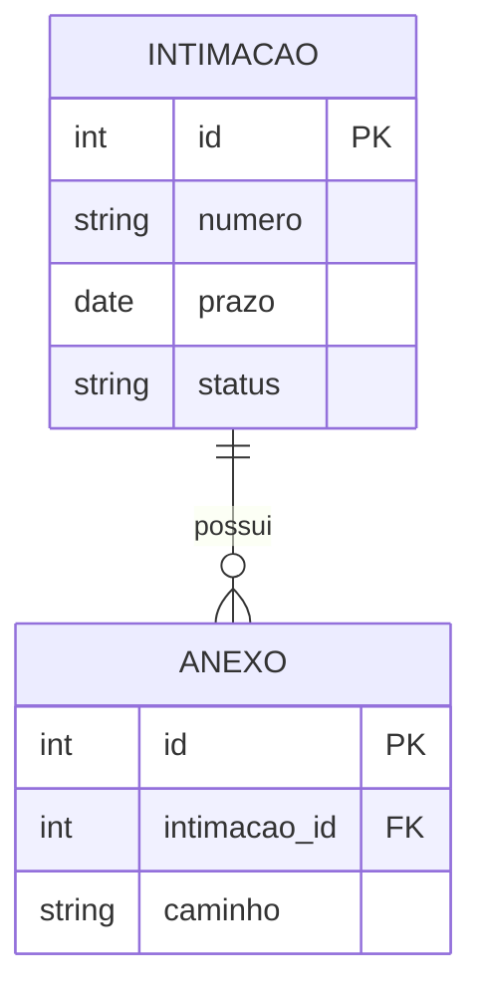
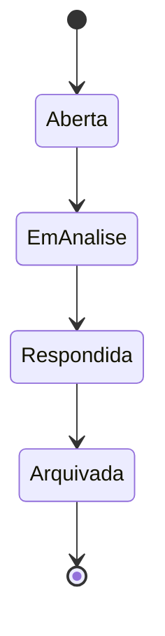
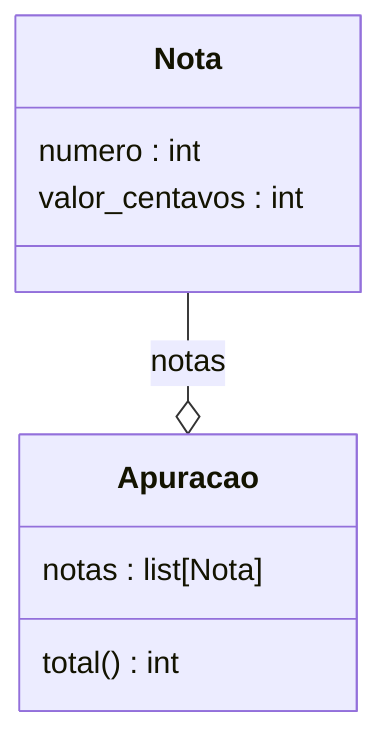
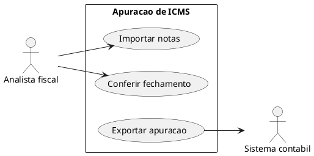
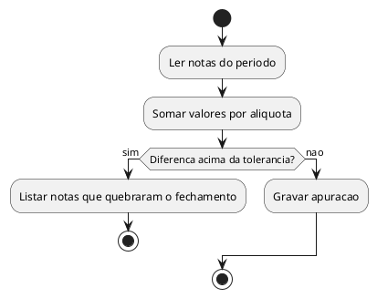

# ARCHITECTURE.md — Diagramas de Arquitetura

Documento vivo, gerado em `docs/ARCHITECTURE.md` ao final de A2. Usa **Mermaid** como padrão, porque o GitHub o desenha nativamente (README, issues, PRs), assim como o Google Antigravity, sem plugin nem servidor. O **PlantUML** entra só onde o Mermaid não atende bem: casos de uso e atividade. Os diagramas de classes e de pacotes não são desenhados à mão: saem do código. É a base do portfólio de engenharia e arquitetura de software.

## Índice
- [Princípios](#princípios)
- [Onde mora cada diagrama](#onde-mora-cada-diagrama)
- [Seção de diagramas do README](#seção-de-diagramas-do-readme)
- [Estrutura do arquivo](#estrutura-do-arquivo)
- [Templates Mermaid](#templates-mermaid): contexto, fluxo principal, componentes internos, implantação, modelo de dados (ER) e máquina de estados
- [Classes e pacotes gerados do código](#classes-e-pacotes-gerados-do-código)
- [PlantUML: casos de uso e atividade](#plantuml-casos-de-uso-e-atividade)
- [Sobre C4](#sobre-c4)
- [Quando atualizar](#quando-atualizar)

## Princípios

- Um `ARCHITECTURE.md` por projeto, em `docs/` (criar a pasta se não existir).
- **Cada diagrama mora num lugar só.** Contexto e fluxo principal ficam no `README.md` do projeto, que é o que lê quem chega ao repositório ou é de outra área; o `ARCHITECTURE.md` traz os demais e aponta para o README, sem repetir.
- Diagramas primeiro, texto curto de apoio depois. O diagrama é o protagonista.
- Sem emojis no conteúdo (regra global). Rótulos de nós em português.
- Cada diagrama tem um título e uma frase explicando o que ele mostra.
- Escolher o tipo de diagrama pelo que precisa comunicar, não usar todos por padrão.
- Diagrama gerado do código não se edita à mão: muda o código e roda o script.

## Onde mora cada diagrama

| Diagrama | Ferramenta | Onde | Quando |
| --- | --- | --- | --- |
| Contexto | Mermaid (`graph`) | `README.md` | Sempre |
| Fluxo principal | Mermaid (`sequenceDiagram`) | `README.md` | Sempre |
| Componentes internos | Mermaid (`graph`) | `ARCHITECTURE.md` | Sempre |
| Implantação | Mermaid (`flowchart` com `subgraph`) | `ARCHITECTURE.md` | Projeto que roda em mais de um lugar |
| Classes | Gerado do código (pyreverse) | `ARCHITECTURE.md`, entre marcadores | Projeto Python |
| Pacotes | Gerado do código (pyreverse) | `ARCHITECTURE.md`, entre marcadores | Projeto Python |
| Modelo de dados (ER) | Mermaid (`erDiagram`) | `ARCHITECTURE.md` | Há persistência |
| Máquina de estados | Mermaid (`stateDiagram-v2`) | `ARCHITECTURE.md` | Um registro tem status |
| Casos de uso | PlantUML | `docs/uml/`, imagem no `ARCHITECTURE.md` | Projeto com usuário ou área externa |
| Atividade | PlantUML | `docs/uml/`, imagem no `ARCHITECTURE.md` | Projeto com usuário ou área externa |
| Objetos e tempo | PlantUML | `docs/uml/` | Sob demanda |

Classes e pacotes só são gerados em projeto Python por enquanto; outra stack ganha gerador sob demanda. Até lá, o projeto de outra stack fica sem esses dois diagramas, em vez de ter um desenhado à mão que envelhece longe do código.

Tipos da UML que o ecossistema não usa:

- **Comunicação:** mostra as mesmas mensagens do diagrama de sequência, arrumadas por objeto; o de sequência já cobre, e o GitHub o desenha.
- **Visão geral de interação:** é uma atividade cujos passos são sequências; os dois diagramas separados dizem o mesmo com menos sintaxe.
- **Estrutura composta:** detalha as partes internas de uma classe; no tamanho destes projetos, componentes e classes bastam.
- **Perfil:** estende a própria UML com estereótipos; só serve a quem cria linguagem de modelagem.

## Seção de diagramas do README

Contexto e fluxo principal moram no `README.md` do projeto, numa seção própria entre marcadores. O agente `project-documentation` mantém só o que está entre eles; o resto do README não é dele. Escritos para quem é de outra área: rótulos na linguagem do negócio, sem nome de classe nem de função.

```markdown
## Como o sistema funciona

<!-- fuzkrigo:diagramas-readme:inicio -->
### Contexto
[Uma frase: quem usa o sistema e com o que ele conversa]
[Diagrama de contexto em Mermaid]

### Fluxo principal
[Uma frase: o caso de uso central, passo a passo]
[Diagrama de sequência em Mermaid]
<!-- fuzkrigo:diagramas-readme:fim -->
```

## Estrutura do arquivo

Template do documento. A seção 4 vem com os marcadores dos diagramas gerados, vazios, e só existe em projeto Python.

```markdown
# Arquitetura — [Nome do Projeto]

Visão de arquitetura do sistema. Atualizado em [data]. O contexto e o fluxo principal estão no [README](../README.md#como-o-sistema-funciona).

## 1. Componentes internos
[Diagrama de componentes/módulos e suas relações]

## 2. Implantação
[Onde cada parte roda: máquina do usuário, servidor, serviço externo. Só quando o projeto roda em mais de um lugar]

## 3. Casos de uso e atividade
[Imagens dos diagramas PlantUML de docs/uml/, em projeto com usuário ou área externa]


## 4. Modelo de domínio
Gerados do código por `.github/scripts/diagrams-code.sh generate`. Não editar entre os marcadores.

### Classes
<!-- fuzkrigo:diagrama-classes:inicio -->
<!-- fuzkrigo:diagrama-classes:fim -->

### Pacotes
<!-- fuzkrigo:diagrama-pacotes:inicio -->
<!-- fuzkrigo:diagrama-pacotes:fim -->

## 5. Modelo de dados
[ER das entidades principais, quando há persistência]

## 6. Estados
[Máquina de estados, quando um registro tem status]

## 7. Decisões de arquitetura
[Lista curta: decisão, alternativa descartada, justificativa. Espelha o ROADMAP.md]
```

## Templates Mermaid

### Contexto (README; nível macro, estilo C4 Contexto)
Mostra o sistema no centro, quem usa e com o que conversa.



### Fluxo principal (README)
Passo a passo do caso de uso central. Bom também para documentar a lógica na Documentação Técnica (C2).



### Componentes internos
Módulos do sistema e dependências entre eles.



### Implantação
Onde cada parte roda, para projeto que roda em mais de um lugar. Um `subgraph` por lugar: máquina do usuário, servidor, serviço externo. Pela mesma regra de "Sobre C4", é `flowchart`, não o `C4Deployment` nativo.



### Modelo de dados (ER)
Entidades e relacionamentos, quando há persistência.



### Máquina de estados
Útil para status de um registro (ex.: intimação em aberto → respondida → arquivada).



## Classes e pacotes gerados do código

Em projeto Python, os diagramas de classes e de pacotes do modelo de domínio são gerados pelo pyreverse, que vem com o pylint, e gravados entre os marcadores da seção 4. O script é `.github/scripts/diagrams-code.sh`, provisionado em A3:

```bash
bash .github/scripts/diagrams-code.sh generate   # grava os dois diagramas no docs/ARCHITECTURE.md
bash .github/scripts/diagrams-code.sh check      # o que o CI roda: reprova se o trecho nao bate com o codigo
```

- **Quais pastas:** as do `coverage.businessLogicPaths` do `fuzkrigo.config.json`, que são o modelo de domínio. Cada padrão termina em `/**` (`src/dominio/**` vira a pasta `src/dominio`); padrão de outro formato reprova. Com mais de uma pasta, sai um diagrama de classes com todas.
- **Pacote regular:** cada pasta precisa de `__init__.py`. Sem ele, ou com erro de sintaxe num arquivo, o pyreverse sai sem erro e com o diagrama vazio; o script barra os dois casos.
- **Onde roda:** na máquina, com o pylint nas dependências de desenvolvimento do projeto e o ambiente virtual ativo. Não precisa de `--source-roots` nem de rodar de dentro de `src`: o caminho a partir da raiz dá o mesmo diagrama. No CI, o script instala o pylint quando o projeto não o trouxe.
- **Marcadores:** um par por diagrama, cada marcador sozinho na linha. Entre eles o script grava um aviso de "não editar à mão" e o bloco ` ```mermaid `. Marcador ausente, repetido ou fora de ordem reprova, nos dois modos. Domínio ainda sem classe recebe uma frase no lugar do bloco, porque o Mermaid recusa o diagrama vazio.
- **Fim de linha:** o arquivo salvo no Windows (CRLF) e o lido no CI (LF) passam do mesmo jeito; o `generate` mantém o fim de linha que o arquivo já usa.

Exemplo do que o `generate` grava no lugar dos marcadores de classes:

````markdown
<!-- fuzkrigo:diagrama-classes:inicio -->
<!-- gerado por .github/scripts/diagrams-code.sh generate; nao editar a mao / generated by .github/scripts/diagrams-code.sh generate; do not edit by hand -->

<!-- fuzkrigo:diagrama-classes:fim -->
````

**O diagrama é tão bom quanto as anotações de tipo.** Atributo com tipo anotado vira relação: `notas: list[Nota]` gerou `Nota --o Apuracao`. No pylint 4.1.3, não viraram relação: `itens: list[Item] = field(default_factory=list)` numa dataclass, `ultima: Nota | None` e `por_serie: dict[str, list[Nota]]`. O diagrama de pacotes usa só o último nome do módulo: `dominio/notas/modelo.py` e `dominio/fiscal/modelo.py` saem os dois como `modelo`.

Se o `check` do CI reprovar logo depois de um `generate`, compare a versão do pylint que o script imprime no log com a da máquina: versões diferentes podem gerar diagramas diferentes.

## PlantUML: casos de uso e atividade

**Quando.** Casos de uso e atividade são padrão em todo projeto com usuário ou área externa: são os diagramas que se mostram a quem não lê código, no `ARCHITECTURE.md` e, no C2, no `MANUAL.md` e na `APRESENTACAO.md`. Objetos e tempo, sob demanda. Componentes e implantação ficam no Mermaid.

**Onde.** `docs/uml/<nome>.puml` e, ao lado, `docs/uml/<nome>.svg`, versionados os dois: o GitHub mostra o SVG como imagem, com a diferença visual entre versões, mas não desenha PlantUML. Um diagrama por arquivo (um só `@startuml` ... `@enduml`). O nome do SVG vem do nome do arquivo, mesmo que o `@startuml` traga outro.

**A imagem no Markdown.** O `ARCHITECTURE.md` e o `MANUAL.md` ficam em `docs/`, então o caminho é relativo a ela:

```markdown

```

**Os comandos**, da raiz do projeto, com o script `.github/scripts/diagrams-uml.sh` provisionado em A3 (em A2, antes do `.github/` existir, o mesmo script roda de `~/.claude/references/github/scripts/`):

```bash
bash .github/scripts/diagrams-uml.sh render           # gera o SVG de cada .puml de docs/uml/
bash .github/scripts/diagrams-uml.sh check            # o que o CI roda
bash .github/scripts/diagrams-uml.sh pdf casos-de-uso # PDF para apresentacao, numa pasta temporaria fora do repositorio
```

O PDF é só para apresentação e nunca é versionado. Erro de sintaxe num `.puml` sai com a linha (`Error line 4 in file: ...`), e nenhum SVG é gravado para ele.

**O que precisa na máquina.** Java 11 ou mais novo (Temurin 21 neste ecossistema) e o `plantuml.jar`, baixado de `https://github.com/plantuml/plantuml/releases/latest/download/plantuml.jar` para `~/plantuml/plantuml.jar`, ou para outro caminho apontado por `PLANTUML_JAR`. O script não baixa nada sozinho. No Windows, o GraphViz de que os casos de uso precisam já vem dentro do jar.

**Como o CI confere: pelo fonte, não pelo desenho.** O SVG traz o `.puml` codificado em `<?plantuml-src ...?>`, e o `-computeurl` codifica o `.puml` atual do mesmo jeito; o `check` compara os dois, roda o `--check-syntax` e reprova SVG sem `.puml`. Comparar o desenho reprovaria por diferença de GraphViz entre o Windows, onde o SVG é gerado, e o Linux do CI, que nem tem GraphViz. Testado no PlantUML 1.2026.9: a codificação é a mesma com o `.puml` em CRLF ou em LF, no Windows e no Linux, com Java 17 e 21, e o SVG gerado pelo 1.2026.9 passou na conferência do 1.2026.10. Por isso a `docs/uml/` não precisa de `.gitattributes`.

### Casos de uso
Quem usa o sistema e o que cada um faz com ele. Ator externo (pessoa ou sistema) fora do retângulo.



### Atividade
O passo a passo de um processo, com as decisões. Bom para a regra de fechamento: o caminho de falha aparece no desenho.



## Sobre C4

Para projetos maiores, seguir a lógica do modelo C4 usando `graph` do Mermaid: nível 1 Contexto, nível 2 Contêineres, nível 3 Componentes. Não é necessário o `C4Context` nativo do Mermaid (suporte ainda instável em alguns renderizadores) — os `graph TB/LR` acima cobrem os níveis com portabilidade total. A implantação segue a mesma regra, com `flowchart` e `subgraph` no lugar do `C4Deployment`.

## Quando atualizar

O `ARCHITECTURE.md` é vivo, mantido pelo agente `project-documentation`, junto com a seção de diagramas do `README.md` e os `.puml` de `docs/uml/`. Nasce em A2, é atualizado no Portão 3 do Bloco B (quando a feature mexeu na estrutura) e consolidado em C2. Invocá-lo quando:
- Um novo módulo ou integração externa entra.
- Uma decisão de arquitetura muda (refletir também no ROADMAP.md).
- O modelo de dados ganha ou perde entidades.
- Um caso de uso ou um processo visto por usuário muda.

Os diagramas gerados não esperam o agente: antes de todo PR, `diagrams-code.sh generate` quando o código de domínio mudou e `diagrams-uml.sh render` quando um `.puml` mudou, porque o CI confere os dois.

Cada atualização acompanha a mudança de código, não fica para depois.
